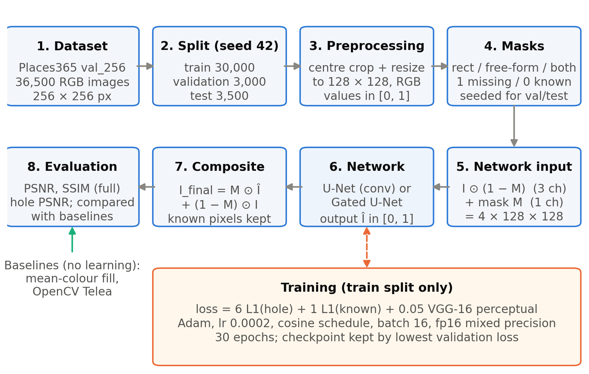
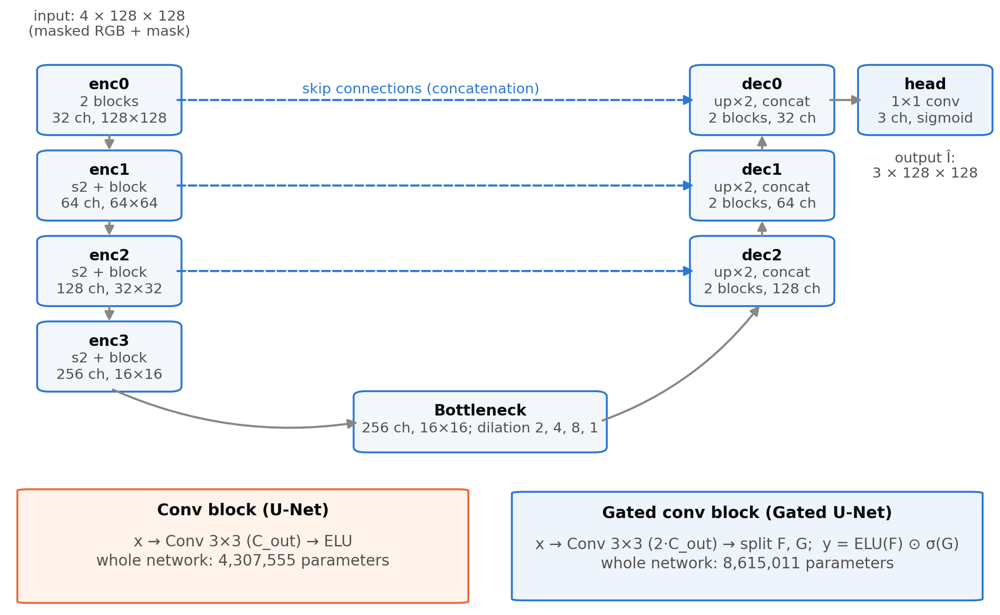
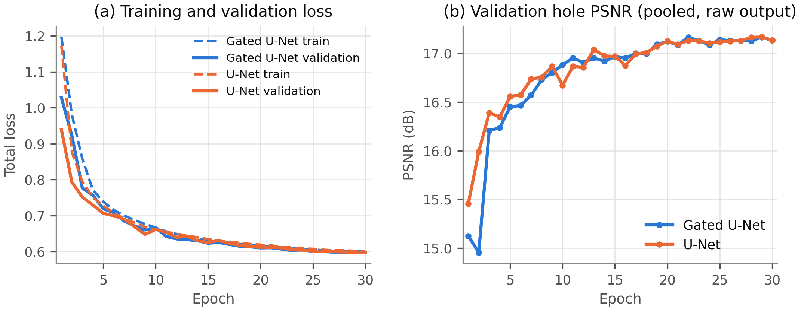
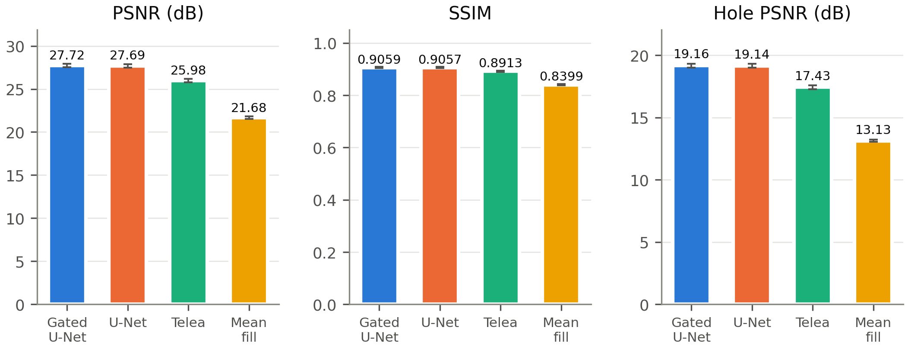
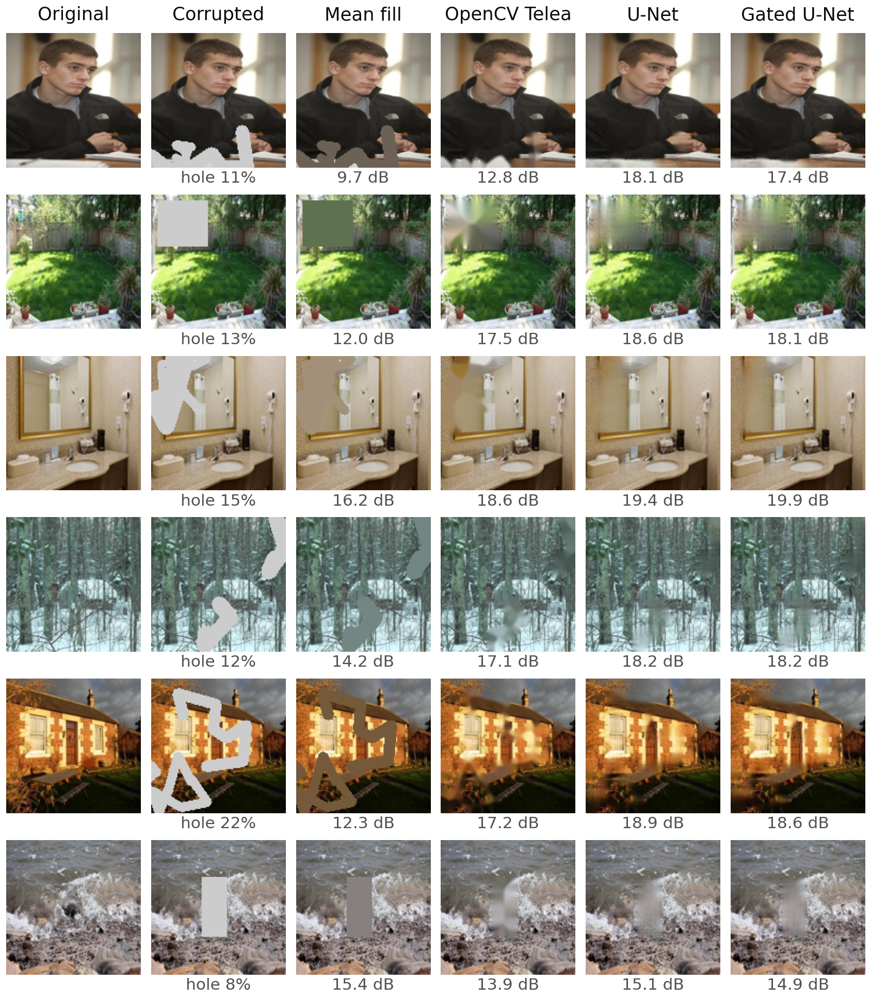
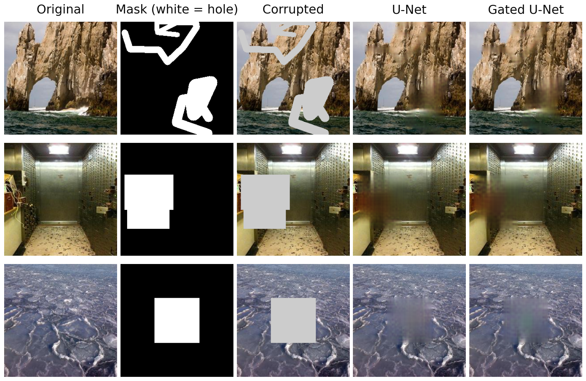
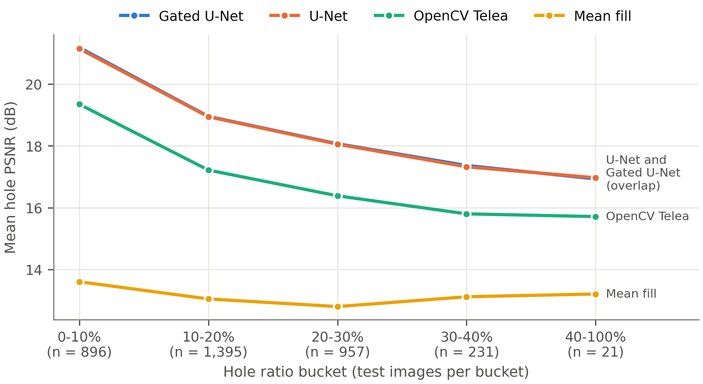

A Mini-Project Report

on

**Image Inpainting Using U-Net and Gated-Convolution U-Net: A Comparative Study**

Submitted in partial fulfilment of the requirements for the award of the degree of

[Degree Name] in [Branch / Specialisation]

Submitted by

[Student Name]

[Register Number]

Under the guidance of

[Faculty Guide], [Designation]

[Department]

[Institution]

[Academic Year]

# Abstract

Image inpainting is the task of filling missing or damaged regions of an image so that the completed image is visually plausible and consistent with its surroundings. This mini-project implements and compares two deep encoder–decoder networks for free-form image inpainting: a U-Net built from ordinary convolutions and a U-Net of identical topology built from gated convolutions. Both networks receive the corrupted image together with a binary mask and predict the full image; the final result keeps every known pixel unchanged and takes only the missing pixels from the network prediction. The models were trained for 30 epochs each on 30,000 scene photographs from the Places365 validation set, resized to 128 × 128 pixels, using randomly generated rectangular and brush-stroke masks and a loss that combines a weighted L1 reconstruction term with a VGG-16 perceptual term. On a held-out test set of 3,500 images with fixed, seeded masks, the gated-convolution U-Net reached a PSNR of 27.72 dB, an SSIM of 0.9059 and a hole PSNR of 19.16 dB, against 27.69 dB, 0.9057 and 19.14 dB for the ordinary U-Net. Both networks clearly outperformed two non-learned baselines, OpenCV's implementation of Telea's fast-marching method (hole PSNR 17.43 dB) and mean-colour filling (13.13 dB). The difference between the two networks (+0.022 dB in hole PSNR) is statistically detectable but practically negligible and rests on a single training run per model. The reconstructions are plausible in colour and coarse structure but blurred inside large holes, and fine textures are not recovered.

## Keywords

Image inpainting; U-Net; gated convolution; encoder–decoder network; free-form masks; perceptual loss; PSNR; SSIM; Places365; deep learning.

# Table of Contents

- 1. Introduction
    - 1.1 Background
    - 1.2 Problem Statement
    - 1.3 Motivation
    - 1.4 Objectives
    - 1.5 Scope of the Project
- 2. Literature Review
    - 2.1 Image Inpainting Approaches
    - 2.2 Encoder–Decoder Architectures
    - 2.3 U-Net
    - 2.4 Gated Convolution
    - 2.5 Traditional Inpainting Methods Used as Baselines
    - 2.6 Research Gap and Motivation for the Comparison
- 3. System Requirements and Tools
- 4. Dataset Description and Preparation
    - 4.1 Dataset Source
    - 4.2 Dataset Splits
    - 4.3 Image Resolution and Preprocessing
    - 4.4 Mask Generation and Mask Types
- 5. Proposed Methodology
    - 5.1 Overall Pipeline
    - 5.2 Input and Output Representation
    - 5.3 Model Architectures
    - 5.4 Training Procedure
    - 5.5 Loss Function and Hyperparameters
    - 5.6 Reconstruction and Preservation of Known Pixels
- 6. Implementation Details
- 7. Experimental Setup
- 8. Evaluation Metrics
    - 8.1 Peak Signal-to-Noise Ratio (PSNR)
    - 8.2 Structural Similarity Index (SSIM)
    - 8.3 Hole PSNR
    - 8.4 Metrics Not Computed
- 9. Results and Discussion
    - 9.1 Training Behaviour
    - 9.2 Quantitative Comparison
    - 9.3 Qualitative Comparison
    - 9.4 U-Net versus Gated U-Net
    - 9.5 Comparison with Telea and Mean Fill
    - 9.6 Performance on Large Missing Regions
- 10. Limitations
- 11. Future Enhancements
- 12. Conclusion
- References

# 1. Introduction

## 1.1 Background

Digital images are frequently incomplete. Photographs may contain scratches, occluding objects, text overlays or regions that a user wishes to remove, and transmitted images may lose blocks of pixels. *Image inpainting* (also called image completion) is the process of estimating the missing pixels from the visible part of the image. The term was introduced to digital image processing by Bertalmio *et al.* [1], whose method propagated image information into the missing region along isophote directions. Later classical approaches either diffuse colours smoothly from the boundary of the hole, such as Telea's fast-marching method [2], or copy patches from the known region, such as exemplar-based inpainting [3].

Classical methods work well for thin scratches and small holes but cannot invent content that does not appear near the hole. Deep convolutional neural networks changed this situation by learning, from large image collections, what natural images typically look like. Context Encoders [4] showed that an encoder–decoder network can predict a large missing region, and subsequent work extended learned inpainting to arbitrary hole shapes and larger images [5], [6], [7], [8].

## 1.2 Problem Statement

Given an RGB image *I* and a binary mask *M* of the same size, in which 1 marks a missing pixel and 0 a known pixel, the goal is to produce an image whose known pixels equal those of *I* and whose missing pixels are a plausible completion. The network only observes the corrupted image

$$I_{\mathrm{in}} = I \odot (1 - M) \qquad (1)$$

and the mask *M*, where ⊙ denotes element-wise multiplication. It predicts a full image *Î*, and the final output is the composite

$$I_{\mathrm{final}} = M \odot \hat{I} + (1 - M) \odot I \qquad (2)$$

which, by construction, leaves every known pixel unchanged. The specific question studied in this project is whether replacing ordinary convolutions by *gated* convolutions [8] inside an otherwise identical U-Net [9] improves reconstruction quality on free-form holes, and how both networks compare with simple non-learned baselines.

## 1.3 Motivation

Ordinary convolutions treat every input pixel in the same way, even though in inpainting the pixels inside the hole carry no information; they are simply set to zero. Gated convolution was proposed to address exactly this: every layer learns a soft, per-pixel and per-channel gate that can suppress unreliable features [8]. Comparing the two kinds of layers under controlled conditions (same topology, data, masks, loss, optimiser and training budget) isolates the effect of the gating mechanism. The project also deliberately works within the limits of modest hardware, a laptop GPU with 4 GB of memory, which is representative of the resources available for student projects.

## 1.4 Objectives

The objectives of the project were to:

1. build a reproducible data pipeline that splits a public image dataset into fixed training, validation and test sets and generates reproducible free-form masks;
2. implement a U-Net inpainting network with ordinary convolutions and a variant with gated convolutions that differs only in the convolution block;
3. train both networks under identical settings with a reconstruction and perceptual loss;
4. implement two non-learned baselines (mean-colour fill and Telea inpainting);
5. evaluate all four methods on the same held-out test images with the same masks, using PSNR, SSIM and hole PSNR; and
6. analyse the results quantitatively and qualitatively, including the dependence on hole size.

## 1.5 Scope of the Project

The project covers training and evaluation at a resolution of 128 × 128 pixels on natural scene photographs, with masks covering on average about 16.7 % of the image. It does not include adversarial (GAN) training, attention mechanisms, user-guided inpainting, high-resolution inpainting or video. Only one training run (one random seed) was carried out per network, and the perceptual metric LPIPS [10] was not computed. A command-line tool for inpainting user-supplied images at arbitrary resolution exists in the code base and is used for illustration only.

# 2. Literature Review

## 2.1 Image Inpainting Approaches

Inpainting methods can be grouped into three families. *Diffusion-based* methods propagate information from the hole boundary inward. Bertalmio *et al.* [1] transported image smoothness information along isophotes using partial differential equations, and Telea [2] proposed a faster method in which pixels are filled in order of their distance from the boundary (computed with the fast marching method), each as a weighted average of already-known neighbours. Diffusion methods produce smooth fills and are effective for thin defects, but they blur large regions and cannot synthesise texture.

*Exemplar-based* methods fill the hole by copying patches from the known part of the image. Criminisi *et al.* [3] prioritised patches along strong edges so that linear structures are continued before textures are filled. Such methods can reproduce texture but rely on suitable patches being present in the same image and have no semantic understanding of the scene.

*Learning-based* methods train a neural network on many images. Pathak *et al.* [4] introduced Context Encoders, which combined a reconstruction loss with an adversarial loss to fill large missing regions such as a central square. Iizuka *et al.* [5] used dilated convolutions and global and local discriminators to handle holes at arbitrary positions, and Yu *et al.* [6] added a contextual attention layer that explicitly borrows features from distant known regions. More recent work has addressed very large masks with fast Fourier convolutions [11] and has applied denoising diffusion models to inpainting [12].

## 2.2 Encoder–Decoder Architectures

An encoder–decoder network compresses its input into a lower-resolution representation and then expands it back to the input size [13]. For inpainting, the encoder aggregates context from the visible region and the decoder synthesises the output image. Down-sampling enlarges the receptive field, which is essential because pixels in the centre of a large hole are far from any known pixel. Dilated convolutions [14] enlarge the receptive field further without additional down-sampling and are widely used in inpainting bottlenecks [5], [6].

## 2.3 U-Net

The U-Net of Ronneberger *et al.* [9] adds skip connections that concatenate encoder feature maps with decoder feature maps of the same resolution. The decoder therefore receives fine spatial detail directly instead of having to reconstruct it from the compressed bottleneck. U-Nets were developed for biomedical image segmentation but are now a standard backbone for image-to-image tasks, including inpainting: the partial-convolution model of Liu *et al.* [7], for example, is built on a U-Net-like architecture.

## 2.4 Gated Convolution

In an ordinary convolution all input locations are treated as equally valid. Liu *et al.* [7] proposed *partial convolutions*, which renormalise each convolution by the number of valid input pixels and update a binary validity mask from layer to layer. Yu *et al.* [8] argued that such a hard, rule-based mask update is limiting and proposed *gated convolution*, in which each layer computes, alongside its features, a learned soft gate:

$$y = \phi(W_f * x) \odot \sigma(W_g * x) \qquad (3)$$

where *W*~f~ and *W*~g~ are two convolution kernels, ∗ denotes convolution, σ is the logistic sigmoid and φ is an activation function (biases are omitted for brevity). The gate lets the network decide, for every spatial position and channel, how much of the feature to pass on, and it can learn to treat hole pixels, known pixels and pixels near the hole boundary differently. The gated-convolution network of Yu *et al.* is a two-stage, coarse-to-fine model trained with an adversarial loss; this project uses only the gated convolution layer itself, inside a single-stage U-Net.

## 2.5 Traditional Inpainting Methods Used as Baselines

Two non-learned methods serve as reference points. *Mean-colour filling* replaces every missing pixel with the average colour of the known pixels of the same image; it represents the simplest possible fill and gives a lower bound. *Telea's method* [2], available in OpenCV as `cv2.inpaint` with the `INPAINT_TELEA` flag, is a widely used, fast diffusion-type algorithm. Neither method uses training data.

## 2.6 Research Gap and Motivation for the Comparison

Published inpainting systems usually combine several ingredients at once, such as gated convolutions, attention modules, multi-stage refinement and adversarial losses, and are trained for days on large GPUs. It is therefore difficult for a student to judge how much a single ingredient contributes under a small compute budget. This project isolates one ingredient: the gated convolution block is compared with an ordinary convolution block while everything else is held fixed, under a training budget of a few GPU-hours on a 4 GB laptop GPU.

# 3. System Requirements and Tools

All experiments were run on a single laptop computer. Table 1 lists the hardware and Table 2 the software actually used; version numbers were read from the project's Python environment.

Table: Table 1. Hardware and operating environment.

| Item | Specification |
|---|---|
| GPU | NVIDIA GeForce RTX 3050 Laptop GPU, 4 GB VRAM |
| CPU / RAM | 12 logical cores / 11 GiB (as visible to WSL 2) |
| Operating system | Ubuntu 22.04.3 LTS under Windows Subsystem for Linux 2 (WSL 2) |

Table: Table 2. Software used.

| Software | Version | Purpose |
|---|---|---|
| Python | 3.10.12 | Programming language |
| PyTorch [15] | 2.6.0+cu124 (CUDA 12.4) | Neural networks, training, mixed precision |
| Torchvision | 0.21.0+cu124 | VGG-16 model and weights, image grids |
| NumPy | 2.2.6 | Array processing |
| OpenCV (headless) | 5.0.0 | Mask drawing, Telea inpainting [16] |
| Pillow | 12.3.0 | Image loading and resizing |
| scikit-image [17] | 0.25.2 | SSIM computation |
| Matplotlib | 3.10.9 | Figures |
| PyYAML | 6.0.3 | Configuration files |

The pre-trained ImageNet weights of VGG-16 used by the perceptual loss were obtained through Torchvision [18]. All dependencies are listed with exact versions in the project's `requirements.txt`.

# 4. Dataset Description and Preparation

## 4.1 Dataset Source

The images come from the validation set of Places365-Standard [19], a scene-recognition dataset published by MIT CSAIL [20]. The project used the archive `val_256.tar`, which contains 36,500 scene photographs pre-resized to 256 × 256 pixels. The scene labels are not used; the images serve only as a diverse collection of natural indoor and outdoor scenes. Every image was decoded and validated before use, and all 36,500 images were found to be valid. In a sample of 2,028 images taken for statistics, all were 256 × 256 pixels, and 6 were greyscale; greyscale images are converted to three-channel RGB when loaded.

## 4.2 Dataset Splits

The list of images was sorted and shuffled with a fixed seed (42), and then divided into three disjoint subsets (Table 3). The split was verified after preparation: every listed file exists, no file appears in more than one subset, and together the subsets cover all 36,500 images. The training set was used only for fitting the network weights, the validation set only for selecting the checkpoint and for reporting intermediate results, and the test set only once, for the final evaluation.

Table: Table 3. Dataset splits.

| Subset | Images | Use |
|---|---:|---|
| Training | 30,000 | Weight updates (random masks, random horizontal flips) |
| Validation | 3,000 | Checkpoint selection (first 1,000 images, every epoch); validation evaluation (all images) |
| Test | 3,500 | Final, one-time evaluation with fixed masks |
| **Total** | **36,500** | |

## 4.3 Image Resolution and Preprocessing

Each image is loaded with Pillow, converted to RGB, centre-cropped to the largest square (a no-op for these already square images) and resized to 128 × 128 pixels with bicubic interpolation. Pixel values are scaled to the range [0, 1] and stored as 32-bit floating-point tensors of shape 3 × 128 × 128. The resolution of 128 pixels was chosen so that training fits comfortably in 4 GB of GPU memory. During training only, images are flipped horizontally with probability 0.5.

## 4.4 Mask Generation and Mask Types

Masks are binary arrays of size 128 × 128 with 1 for a missing pixel and 0 for a known pixel. The project's mask generator produces three mask families (Figure 1a):

* **Rectangles** (drawn with probability 0.35): between one and three axis-aligned rectangles, each with height and width drawn uniformly between 15 % and 50 % of the image side, at random positions.
* **Free-form strokes** (probability 0.45): between one and four brush strokes. Each stroke is a random walk of one to eight straight segments, each segment up to 30 % of the image side long, drawn with a thickness of up to 12 % of the image side and with round joints. This follows the spirit of the free-form masks of Yu *et al.* [8] but is a simplified re-implementation.
* **Both** (probability 0.20): the union of one rectangle and a set of free-form strokes.

Every mask contains at least one missing pixel. During training a new random mask is drawn for every image in every epoch, so the network never sees the same image–mask pair twice. For validation and testing, the mask for the *i*-th image is generated from a fixed seed (42 + 1,000,000 + *i* for validation and 42 + 2,000,000 + *i* for testing), so every method and every run is evaluated on exactly the same masks. Over the 3,500 test masks, the fraction of missing pixels (the *hole ratio*) has a mean of 16.7 %, a median of 16.0 % and a maximum of 51.7 % (Figure 1b).

{width=100%}

# 5. Proposed Methodology

## 5.1 Overall Pipeline

Figure 2 summarises the complete system. Images are split and preprocessed once (Section 4). For every image a mask is generated, the corrupted image and the mask are stacked into a four-channel input, and the network predicts a complete three-channel image. The composite of Equation (2) is then formed, so that only the missing pixels come from the network. During training, the loss of Section 5.5 is minimised on the training split; during evaluation, the composite is compared with the original image using the metrics of Section 8, and the same corrupted inputs are also given to the two baselines.

{width=100%}

## 5.2 Input and Output Representation

The network input is a tensor of shape 4 × 128 × 128: the three colour channels of the corrupted image of Equation (1), in which missing pixels are set to zero, followed by the mask channel. Supplying the mask explicitly tells the network which zeros are missing data and which are genuinely black pixels. The output is a tensor of shape 3 × 128 × 128 produced by a sigmoid function, so every predicted value lies in [0, 1] like the input images.

## 5.3 Model Architectures

Both networks share the U-Net topology shown in Figure 3 and listed in Table 4, with a base width of *c* = 32 channels. The encoder has four stages. The first stage consists of two convolution blocks at full resolution; each further stage halves the resolution with a stride-2 block and doubles the number of channels, reaching 256 channels at 16 × 16 pixels. The bottleneck consists of four blocks with dilation rates 2, 4, 8 and 1, which enlarge the receptive field so that pixels deep inside a large hole can draw on distant context [14]. The decoder has three stages; each up-samples by a factor of two with nearest-neighbour interpolation, concatenates the encoder features of the same resolution (skip connection), and applies two blocks. Nearest-neighbour up-sampling followed by convolution was chosen instead of transposed convolution to avoid checkerboard artefacts [21]. A final 1 × 1 convolution maps to three channels, followed by a sigmoid. All convolutions in the blocks use 3 × 3 kernels with padding equal to the dilation, so the spatial size is preserved except where a stride of 2 is used.

Table: Table 4. Layer configuration shared by both networks (base width *c* = 32, input 128 × 128).

| Stage | Operation | Output channels | Output size |
|---|---|---:|---:|
| enc0 | 2 blocks | 32 | 128 × 128 |
| enc1 | stride-2 block + block | 64 | 64 × 64 |
| enc2 | stride-2 block + block | 128 | 32 × 32 |
| enc3 | stride-2 block + block | 256 | 16 × 16 |
| bottleneck | 4 blocks, dilation 2, 4, 8, 1 | 256 | 16 × 16 |
| dec2 | up-sample ×2, concat enc2, 2 blocks | 128 | 32 × 32 |
| dec1 | up-sample ×2, concat enc1, 2 blocks | 64 | 64 × 64 |
| dec0 | up-sample ×2, concat enc0, 2 blocks | 32 | 128 × 128 |
| head | 1 × 1 convolution + sigmoid | 3 | 128 × 128 |

The two networks differ only in the block used throughout (Figure 3, bottom):

* **U-Net (ordinary convolution).** Each block is a 3 × 3 convolution followed by the exponential linear unit (ELU) activation [22]. The network has 4,307,555 trainable parameters.
* **Gated U-Net.** Each block is a gated convolution following Equation (3), with φ = ELU. In the implementation a single convolution produces 2·*C*~out~ channels, which are split into a feature half *F* and a gate half *G*, and the output is ELU(*F*) ⊙ σ(*G*); this is mathematically identical to using two separate convolutions. Because every convolution produces twice as many channels, the network has 8,615,011 trainable parameters, about twice as many as the ordinary U-Net.

The gated network therefore has more parameters as well as gating, so the comparison is between the two architectures as specified, not between equal-sized networks.

{width=100%}

## 5.4 Training Procedure

Both networks were trained with identical settings (Table 5). Each epoch processes the 30,000 training images in random order in mini-batches of 16 (1,875 iterations per epoch). After every epoch, the network is evaluated on the first 1,000 validation images with their fixed masks, and the model weights are saved whenever the validation loss reaches a new minimum (`best.pt`); the weights after the last epoch are also saved (`last.pt`). Early stopping after six epochs without improvement was enabled but was never triggered, because the validation loss kept decreasing. The weights from the epoch with the lowest validation loss were used for all evaluations; for both networks this was the final epoch, epoch 30.

Mixed-precision training [23] was used to reduce memory and computation: the forward pass of the network runs in 16-bit floating point under PyTorch's automatic mixed precision [24], while the loss is computed in 32-bit floating point, and the gradients are dynamically scaled to avoid underflow. Gradients are clipped to a global norm of 1.0. The original configuration used a batch size of 32; on the 4 GB GPU this required about 3.4 GiB of memory for the U-Net and about 4.1 GiB for the gated network, which exceeds the available memory, so a batch size of 16 was used for both networks (about 1.8 GiB and 2.3 GiB; Section 7).

## 5.5 Loss Function and Hyperparameters

The training objective combines three terms. With the mask *M* broadcast over the three colour channels and *N*~h~ = 3 Σ *M* and *N*~v~ = 3 Σ (1 − *M*) the numbers of missing and known channel values, the hole and valid reconstruction losses are mean absolute errors over the missing and known pixels respectively:

$$L_{\mathrm{hole}} = \frac{1}{N_h} \sum M \odot \left| \hat{I} - I \right| \qquad (4)$$

$$L_{\mathrm{valid}} = \frac{1}{N_v} \sum (1 - M) \odot \left| \hat{I} - I \right| \qquad (5)$$

The perceptual loss [25] compares feature maps of a frozen VGG-16 network [26] pre-trained on ImageNet. With ψ~l~ denoting the activations after layers relu1_2, relu2_2 and relu3_3 (computed on ImageNet-normalised inputs), and *I*~c~ = *M* ⊙ *Î* + (1 − *M*) ⊙ *I* the composite, it is

$$L_{\mathrm{perc}} = \sum_{l=1}^{3} \left( \overline{\left| \psi_l(\hat{I}) - \psi_l(I) \right|} + \overline{\left| \psi_l(I_c) - \psi_l(I) \right|} \right) \qquad (6)$$

where the bar denotes the mean over all elements. The total loss is

$$L = 6\, L_{\mathrm{hole}} + 1\, L_{\mathrm{valid}} + 0.05\, L_{\mathrm{perc}} \qquad (7)$$

The weights of the hole, valid and perceptual terms (6, 1 and 0.05) follow Liu *et al.* [7], although the VGG-16 layers used here differ from theirs; the style and total-variation terms of that work were not used, and no adversarial loss was used. Table 5 lists all hyperparameters.

Table: Table 5. Training hyperparameters (identical for both networks).

| Hyperparameter | Value |
|---|---|
| Image size | 128 × 128 |
| Base width *c* | 32 |
| Loss weights (hole, valid, perceptual) | 6.0, 1.0, 0.05 |
| Perceptual network | VGG-16, ImageNet weights, frozen; relu1_2, relu2_2, relu3_3 |
| Optimiser | Adam [27], β~1~ = 0.9, β~2~ = 0.999 |
| Initial learning rate | 2 × 10^−4^ |
| Learning-rate schedule | Cosine annealing [28] over 30 epochs to 1 × 10^−5^ (no restarts) |
| Batch size | 16 |
| Epochs | 30 (1,875 iterations each) |
| Precision | Mixed (16-bit forward pass, 32-bit loss and weights) |
| Gradient clipping | Global norm 1.0 |
| Model selection | Lowest validation loss (first 1,000 validation images) |
| Random seed | 42 (one run per network) |

## 5.6 Reconstruction and Preservation of Known Pixels

The raw network output *Î* is never used directly as the result. The composite of Equation (2) copies every known pixel from the input, so the method can only change pixels that were missing. This was verified explicitly: for all evaluated images the known pixels of the composite were identical to the original, and in the full-resolution inference examples the saved output images were byte-identical to the original in every known pixel. For images larger than 128 × 128 pixels, the inference tool resizes the image and mask to 128 × 128 (marking a low-resolution pixel as missing if any part of it was missing), predicts the hole, resizes the prediction back to the original size, and composites it with the original full-resolution image. The detail inside the hole is therefore limited by the training resolution.

# 6. Implementation Details

The project is written in Python and organised as a small package (`src/`) with command-line scripts (`scripts/`) and YAML configuration files (`configs/`). Table 6 summarises the main modules.

Table: Table 6. Main modules of the implementation.

| Module | Responsibility |
|---|---|
| `src/datasets/inpainting_dataset.py` | Image loading and preprocessing, split creation, dataset that returns image, mask and corrupted image |
| `src/masks/generator.py` | Rectangle, free-form and mixed mask generation with explicit random generators |
| `src/models/unet.py` | U-Net with ordinary or gated convolution blocks; composite function |
| `src/losses/inpainting_loss.py` | Hole and valid L1 losses; VGG-16 perceptual loss |
| `src/training/trainer.py` | Training loop, mixed precision, validation, checkpointing, logging, early stopping |
| `src/evaluation/` | Metrics (MSE, PSNR, SSIM, hole PSNR), baselines, evaluation over a dataset |
| `src/inference/inpainter.py` | Inpainting of arbitrary-size images with a trained checkpoint |
| `scripts/*.py` | Command-line entry points: data preparation, training, evaluation, inference, smoke test |

Configuration files inherit from a common `default.yaml`. The experiments in this report used `configs/unet_4gb.yaml` and `configs/gated_unet_4gb.yaml`, which differ from the original model configurations only in the batch size (16 instead of 32). A smoke test trains a tiny network for two epochs on synthetic images and checks the forward pass, loss, backward pass, optimiser step, checkpoint saving and loading, evaluation and inference, without downloading data; it was passed for both networks before training. During this testing an error in the gated block was found and corrected before the experiments: an in-place activation was being applied to a tensor view produced by the channel split, which PyTorch's automatic differentiation does not allow.

Each training run writes a per-epoch log (`training_log.csv`, `history.json`), sample images, the resolved configuration and checkpoints to its own directory. Evaluation writes per-image metrics, an aggregated summary and example reconstructions. The training runs reported here were preceded by two short pilot runs of at most 300 iterations on the real data, which served only to check the pipeline and are not reported as results.

# 7. Experimental Setup

Each network was trained once, from random initialisation with seed 42, for 30 epochs on the training split (Table 5). Table 7 summarises the training runs as recorded in the logs. The GPU memory figures are the maxima of `nvidia-smi` readings taken every 30 seconds. One epoch of the gated U-Net run (epoch 27) has a wall-clock duration of 9.0 hours in the log because the computer was suspended overnight during that epoch and training resumed afterwards; the median epoch time is therefore reported.

Table: Table 7. Summary of the two training runs (from the training logs).

| | U-Net | Gated U-Net |
|---|---:|---:|
| Trainable parameters | 4,307,555 | 8,615,011 |
| Epochs completed | 30 | 30 |
| Median time per epoch | 5.8 min | 7.2 min |
| Peak GPU memory (sampled) | 1.79 GiB | 2.27 GiB |
| Final training loss (epoch 30) | 0.6014 | 0.6005 |
| Best validation loss (epoch) | 0.5974 (30) | 0.5969 (30) |

The selected checkpoints were evaluated twice. The **validation evaluation** used all 3,000 validation images and was used to check the models and the evaluation code. The **test evaluation** used all 3,500 test images and was run once, after all modelling decisions had been made; no hyperparameter was changed in response to test results. Both evaluations included the two baselines, which were applied to the same corrupted 128 × 128 inputs. Telea's method was run with an inpainting radius of 3 pixels on 8-bit images, after which the known pixels were restored exactly. All metrics were computed per image on the 128 × 128 images and then averaged.

# 8. Evaluation Metrics

## 8.1 Peak Signal-to-Noise Ratio (PSNR)

For a reconstruction *K* and the original image *I*, both with values in [0, 1], the mean squared error is taken over all *n* pixel values and the PSNR is defined as

$$\mathrm{MSE} = \frac{1}{n} \sum_{j=1}^{n} (K_j - I_j)^2, \qquad \mathrm{PSNR} = 10 \log_{10} \frac{1}{\mathrm{MSE}} \ \mathrm{dB} \qquad (8)$$

Higher values indicate a smaller pixel-wise error. In this report, *PSNR* refers to the composite image over the whole image. Because the known pixels of the composite are exact, the whole-image PSNR depends strongly on the hole size: an image with a small hole scores highly even if the hole is filled poorly. PSNR is also known to correlate only moderately with perceived quality, because it treats all pixel errors alike and favours blurry predictions that average over plausible alternatives [29].

## 8.2 Structural Similarity Index (SSIM)

SSIM [30] compares local luminance, contrast and structure. For two image windows *x* and *y* with means μ, variances σ² and covariance σ~xy~,

$$\mathrm{SSIM}(x, y) = \frac{(2\mu_x\mu_y + C_1)(2\sigma_{xy} + C_2)}{(\mu_x^2 + \mu_y^2 + C_1)(\sigma_x^2 + \sigma_y^2 + C_2)} \qquad (9)$$

where *C*~1~ and *C*~2~ are small constants that stabilise the division. The image SSIM is the mean over all windows. It was computed with scikit-image [17] (`structural_similarity`, 7 × 7 window, data range 1, averaged over the three colour channels) on the composite image. SSIM ranges up to 1 for identical images. Like PSNR, whole-image SSIM is dominated by the unchanged known pixels and therefore varies within a narrow range for the methods compared here.

## 8.3 Hole PSNR

The hole PSNR applies Equation (8) only to the missing pixels (all three channels of every pixel with *M* = 1):

$$\mathrm{PSNR}_{\mathrm{hole}} = 10 \log_{10} \frac{1}{\frac{1}{N_h} \sum M \odot (\hat{I} - I)^2} \ \mathrm{dB} \qquad (10)$$

It measures directly how close the generated content is to the original content and is the most discriminative of the three metrics for this task. Its limitation is the same as that of PSNR: a hole can be filled with plausible content that differs from the original and still be penalised, whereas a blurred average may score better. Higher hole PSNR therefore means closer agreement with the original, not necessarily a more realistic image.

## 8.4 Metrics Not Computed

Learned perceptual metrics such as LPIPS [10] correlate better with human judgement of realism than PSNR and SSIM. LPIPS is supported by the evaluation code but was not computed in this project (the optional package was not installed), so all reported results are pixel-based. No human perceptual study was carried out.

# 9. Results and Discussion

All numbers in this section were read from the saved evaluation files (`results/val_eval/both_4gb/metrics/` for validation and `results/metrics/` for test). Values are means over images, followed where shown by the standard deviation across images (per-image MSE values are also stored in the evaluation files); the standard deviation describes the variation between images, not the uncertainty of the mean.

## 9.1 Training Behaviour

Figure 4 shows the training and validation losses and the validation hole PSNR recorded after every epoch. Both networks converged smoothly, and the training and validation losses remained close throughout, so there is no sign of overfitting. The gated U-Net started more slowly in the first two epochs but reached the same level as the ordinary U-Net by about epoch 7, after which the two curves are almost indistinguishable. Both networks were still improving slightly at epoch 30, so the best checkpoint was the last one in both cases and longer training might bring further small gains. The validation hole PSNR in Figure 4b is computed from the error pooled over the first 1,000 validation images and is therefore lower than the per-image average reported in Tables 8 and 9.

{width=100%}

## 9.2 Quantitative Comparison

Table 8 reports the validation results and Table 9 the final held-out test results. The test results are the main results of this project.

Table: Table 8. Results on the validation set (3,000 images, 128 × 128). Mean ± standard deviation over images; best value in each column in bold.

| Method | PSNR (dB) ↑ | SSIM ↑ | Hole PSNR (dB) ↑ |
|---|---:|---:|---:|
| Gated U-Net | **27.73 ± 6.27** | **0.9050 ± 0.0647** | **19.25 ± 4.70** |
| U-Net | 27.70 ± 6.23 | 0.9048 ± 0.0646 | 19.22 ± 4.65 |
| OpenCV Telea | 25.95 ± 5.85 | 0.8901 ± 0.0692 | 17.47 ± 4.27 |
| Mean fill | 21.76 ± 4.45 | 0.8376 ± 0.0851 | 13.28 ± 3.03 |

Table: Table 9. Results on the held-out test set (3,500 images, 128 × 128). Mean ± standard deviation over images; best value in each column in bold.

| Method | PSNR (dB) ↑ | SSIM ↑ | Hole PSNR (dB) ↑ |
|---|---:|---:|---:|
| Gated U-Net | **27.72 ± 6.25** | **0.9059 ± 0.0645** | **19.16 ± 4.71** |
| U-Net | 27.69 ± 6.21 | 0.9057 ± 0.0644 | 19.14 ± 4.65 |
| OpenCV Telea | 25.98 ± 5.92 | 0.8913 ± 0.0688 | 17.43 ± 4.31 |
| Mean fill | 21.68 ± 4.30 | 0.8399 ± 0.0842 | 13.13 ± 2.89 |

On the test set, the two networks are clearly better than both baselines on every metric (Table 9 and Figure 5). The gated U-Net obtains the highest values on all three metrics, but its margin over the ordinary U-Net is very small: +0.022 dB in PSNR, +0.0002 in SSIM and +0.022 dB in hole PSNR. The validation and test results agree closely (Table 10): the largest difference for either network is below 0.1 dB, which indicates that the test set behaves like the validation set and that model selection on the validation set did not lead to optimistic estimates.

Table: Table 10. Validation versus held-out test results for the two networks (means over images).

| Network | Split | Images | PSNR (dB) | SSIM | Hole PSNR (dB) |
|---|---|---:|---:|---:|---:|
| Gated U-Net | Validation | 3,000 | 27.73 | 0.9050 | 19.25 |
| Gated U-Net | Test | 3,500 | 27.72 | 0.9059 | 19.16 |
| U-Net | Validation | 3,000 | 27.70 | 0.9048 | 19.22 |
| U-Net | Test | 3,500 | 27.69 | 0.9057 | 19.14 |

{width=100%}

## 9.3 Qualitative Comparison

Figure 6 shows the first six test images in the order of the test split, without any selection, together with the outputs of all four methods and the per-image hole PSNR. Mean-colour fill leaves an obvious flat patch. Telea's method continues the colours at the boundary inward, which works for thin strokes but produces smeared streaks and radial artefacts in larger holes (second and fifth rows). Both networks produce fills whose colours and coarse structures continue those of the surrounding image, for example the trees and fence in the second row and the brick wall of the house in the fifth row, but the filled regions are visibly blurred. In the last row, the mean colour of the image happens to be close to the missing content, and mean fill obtains a slightly higher hole PSNR than both networks, which illustrates that a single image can contradict the average trend.

{width=100%}

Figure 7 shows inference with the command-line tool on three validation images at their full resolution of 256 × 256 pixels, with a free-form, a rectangular and a centred square mask. The outputs again show plausible colour and large-scale continuation (rock face, wall, floor) and a lack of fine detail. The third example, a highly textured ice surface, makes the limitation particularly visible: both networks fill the square with a smooth, low-contrast patch instead of reproducing the cracks of the surrounding ice. Because the network operates at 128 × 128 pixels, the up-scaled prediction is additionally softened at 256 × 256 pixels.

{width=100%}

## 9.4 U-Net versus Gated U-Net

Because both networks were evaluated on the same test images with the same masks, their per-image results can be compared directly (Table 11). The mean per-image improvement of the gated U-Net over the ordinary U-Net in hole PSNR is +0.022 dB, with a 95 % confidence interval of [+0.008, +0.037] dB, and the gated network is better on 53.2 % of the test images. The difference is consistent in sign on the validation set (+0.027 dB), but it is about one hundredth of the standard deviation between images and is not visible in the example images (Figures 6 and 7).

Table: Table 11. Paired per-image differences on the test set (first method minus second; 3,500 images). CI: 95 % confidence interval of the mean difference over test images.

| Comparison | Mean Δ hole PSNR (dB) | 95 % CI (dB) | Mean Δ SSIM | Better on |
|---|---:|---:|---:|---:|
| Gated U-Net − U-Net | +0.022 | [+0.008, +0.037] | +0.0002 | 53.2 % |
| Gated U-Net − OpenCV Telea | +1.733 | [+1.676, +1.790] | +0.0146 | 92.3 % |
| U-Net − OpenCV Telea | +1.711 | [+1.654, +1.768] | +0.0144 | 92.3 % |
| OpenCV Telea − Mean fill | +4.300 | [+4.171, +4.428] | +0.0514 | 94.2 % |

This result has to be interpreted with care. First, only one training run with one random seed was carried out for each network, so the confidence interval describes the variation over test images but not the variation between training runs; differences between repeated runs of the same architecture may well be larger than 0.02 dB. Second, the gated network has twice as many parameters, so any advantage cannot be attributed to the gating mechanism alone. Third, the networks were trained for only 30 epochs at low resolution with a pixel-based objective. Under these conditions the experiment does not show a meaningful benefit of gated convolution; its benefits reported by Yu *et al.* [8] were obtained in a different setting (a two-stage network with contextual attention and adversarial training at higher resolution) and cannot be confirmed or refuted by this project.

## 9.5 Comparison with Telea and Mean Fill

Both networks improved on Telea's method by about 1.7 dB in hole PSNR (Table 11; +1.71 dB for the U-Net, better on 92.3 % of the test images) and by about 6 dB on mean fill. Table 12 and Figure 8 show that this advantage holds for every mask family and every hole-size bucket. The advantage is consistent with the networks having learned typical colour and structure statistics of natural scenes from the training data, whereas Telea's method only diffuses boundary colours.

Table: Table 12. Mean hole PSNR (dB) on the test set by mask family.

| Mask family | Images | Gated U-Net | U-Net | OpenCV Telea | Mean fill |
|---|---:|---:|---:|---:|---:|
| Both | 692 | 18.69 | 18.67 | 17.02 | 13.15 |
| Free-form strokes | 1,547 | 20.64 | 20.60 | 18.79 | 13.24 |
| Rectangles | 1,261 | 17.61 | 17.60 | 15.98 | 12.98 |

## 9.6 Performance on Large Missing Regions

Figure 8 and Table 13 show how the hole PSNR depends on the fraction of missing pixels. For all methods except mean fill, the hole PSNR falls as the hole grows: for the gated U-Net it decreases from 21.18 dB for holes below 10 % of the image to 16.93 dB for holes above 40 %. Larger holes contain pixels that are far from any known pixel, so less context is available and the network falls back on smooth, average-looking content. Mean fill is roughly constant because it ignores structure altogether. Rectangular holes were the hardest family for every method (Table 12), presumably because a solid block removes complete objects, whereas thin strokes leave nearby context on both sides of every missing pixel. Only 21 test images had holes larger than 40 %, so the estimate for that bucket is less reliable than the others.

Table: Table 13. Mean hole PSNR (dB) on the test set by hole ratio.

| Hole ratio | Images | Gated U-Net | U-Net | OpenCV Telea | Mean fill |
|---|---:|---:|---:|---:|---:|
| 0-10% | 896 | 21.18 | 21.14 | 19.34 | 13.60 |
| 10-20% | 1,395 | 18.95 | 18.94 | 17.21 | 13.05 |
| 20-30% | 957 | 18.07 | 18.05 | 16.38 | 12.80 |
| 30-40% | 231 | 17.36 | 17.32 | 15.80 | 13.12 |
| 40-100% | 21 | 16.93 | 16.97 | 15.71 | 13.21 |

{width=100%}

The blurring visible in Figures 6 and 7 has two main causes. The L1 reconstruction terms reward predictions that are close to the original *on average*, and when several completions are plausible, the prediction that minimises the expected error is an average of them, which is blurred. The perceptual term reduces but does not remove this effect at the small weight used, and no adversarial loss was used to push the output towards realistic textures. In addition, the low working resolution of 128 × 128 pixels limits the detail that can be represented. It should also be emphasised that the generated content is an estimate: even a high hole PSNR does not mean that the filled region reproduces the true missing content, and objects that are completely hidden by the mask cannot be recovered.

# 10. Limitations

The work has the following limitations, all of which should be considered when interpreting the results:

* **Single run per model.** Each network was trained once with one random seed. The variation between training runs is unknown, so the very small difference between the two networks cannot be attributed reliably to the architecture.
* **Unequal model size.** The gated U-Net has twice as many parameters as the ordinary U-Net; an equal-parameter comparison was not performed.
* **Low resolution and short training.** All training and evaluation used 128 × 128 images and 30 epochs on a 4 GB GPU, with a batch size reduced to 16. Both networks were still improving slightly when training stopped.
* **Pixel-based metrics only.** PSNR, SSIM and hole PSNR reward closeness to the original rather than realism. LPIPS was not computed and no user study was carried out, so the perceptual quality of the outputs is assessed only by visual inspection of examples.
* **Blurred fills.** Large holes and fine textures are filled with smooth, low-detail content; the method is not suitable where realistic texture synthesis is required.
* **Synthetic masks.** The masks are randomly generated rectangles and strokes. Real use cases, such as object removal, involve object-shaped holes, for which performance was not measured.
* **Dataset scope.** Only scene photographs from one dataset were used, at a fixed resolution; performance on other image types (faces, documents, medical images) is unknown.
* **No guarantee of correctness.** The filled content is a plausible estimate, not a recovery of the true missing content, and must not be used where the original content matters (for example, as evidence).

# 11. Future Enhancements

The following extensions are proposed; none of them was implemented in this project.

1. **Repeated runs.** Train each network with several random seeds and report the mean and spread across runs, so that architectural differences can be separated from training noise.
2. **Equal-capacity comparison.** Compare the gated U-Net with an ordinary U-Net widened to the same number of parameters.
3. **Perceptual evaluation.** Compute LPIPS [10] and conduct a small user study to measure realism rather than pixel agreement.
4. **Adversarial and texture losses.** Add an adversarial loss and the style loss of Liu *et al.* [7] to reduce blurring, as in [5], [6], [8].
5. **Larger receptive field and attention.** Add contextual attention [6] or fast Fourier convolutions [11] to borrow information from distant regions, which is particularly important for large holes.
6. **Higher resolution and longer training.** Train at 256 × 256 pixels or above for more epochs, using gradient accumulation to compensate for the small batch size.
7. **Diffusion-based inpainting.** Compare against a denoising diffusion approach such as RePaint [12], which can generate diverse, sharp completions at a higher computational cost.
8. **Realistic masks.** Evaluate on object-shaped masks derived from segmentation datasets.

# 12. Conclusion

This mini-project implemented a complete image inpainting system consisting of a reproducible data pipeline on 36,500 Places365 scene images, a seeded free-form mask generator, two U-Net inpainting networks (with ordinary and with gated convolutions), a reconstruction-plus-perceptual training objective, two non-learned baselines and an evaluation protocol with a held-out test set. Both networks were trained for 30 epochs on a 4 GB laptop GPU.

On 3,500 held-out test images, both networks clearly outperformed mean-colour filling and OpenCV's Telea inpainting, with a hole PSNR of about 19.1–19.2 dB against 17.43 dB and 13.13 dB, and with the advantage holding for all mask types and hole sizes. The gated U-Net achieved the best values on all three metrics (PSNR 27.72 dB, SSIM 0.9059, hole PSNR 19.16 dB), but its advantage over the ordinary U-Net was only about 0.02 dB, came from a single training run per model, and was obtained with twice the number of parameters; it is therefore not evidence of a meaningful benefit of gated convolution in this setting. The reconstructions continue colours and coarse structures convincingly but are blurred, especially in large holes and textured regions. The results are not state of the art, and the proposed enhancements, in particular repeated runs, perceptual metrics, adversarial losses and higher resolution, are natural next steps.

# References

[1] M. Bertalmio, G. Sapiro, V. Caselles, and C. Ballester, "Image inpainting," in *Proc. 27th Annu. Conf. Computer Graphics and Interactive Techniques (SIGGRAPH '00)*, 2000, pp. 417–424, doi: 10.1145/344779.344972.

[2] A. Telea, "An image inpainting technique based on the fast marching method," *Journal of Graphics Tools*, vol. 9, no. 1, pp. 23–34, 2004, doi: 10.1080/10867651.2004.10487596.

[3] A. Criminisi, P. Pérez, and K. Toyama, "Region filling and object removal by exemplar-based image inpainting," *IEEE Transactions on Image Processing*, vol. 13, no. 9, pp. 1200–1212, 2004, doi: 10.1109/TIP.2004.833105.

[4] D. Pathak, P. Krähenbühl, J. Donahue, T. Darrell, and A. A. Efros, "Context encoders: Feature learning by inpainting," in *Proc. IEEE Conf. Computer Vision and Pattern Recognition (CVPR)*, 2016, pp. 2536–2544, doi: 10.1109/CVPR.2016.278.

[5] S. Iizuka, E. Simo-Serra, and H. Ishikawa, "Globally and locally consistent image completion," *ACM Transactions on Graphics*, vol. 36, no. 4, pp. 1–14, 2017, doi: 10.1145/3072959.3073659.

[6] J. Yu, Z. Lin, J. Yang, X. Shen, X. Lu, and T. S. Huang, "Generative image inpainting with contextual attention," in *Proc. IEEE/CVF Conf. Computer Vision and Pattern Recognition (CVPR)*, 2018, pp. 5505–5514, doi: 10.1109/CVPR.2018.00577.

[7] G. Liu, F. A. Reda, K. J. Shih, T.-C. Wang, A. Tao, and B. Catanzaro, "Image inpainting for irregular holes using partial convolutions," in *Computer Vision – ECCV 2018*, Lecture Notes in Computer Science. Cham, Switzerland: Springer, 2018, pp. 89–105, doi: 10.1007/978-3-030-01252-6_6.

[8] J. Yu, Z. Lin, J. Yang, X. Shen, X. Lu, and T. Huang, "Free-form image inpainting with gated convolution," in *Proc. IEEE/CVF Int. Conf. Computer Vision (ICCV)*, 2019, pp. 4470–4479, doi: 10.1109/ICCV.2019.00457.

[9] O. Ronneberger, P. Fischer, and T. Brox, "U-Net: Convolutional networks for biomedical image segmentation," in *Medical Image Computing and Computer-Assisted Intervention – MICCAI 2015*, Lecture Notes in Computer Science. Cham, Switzerland: Springer, 2015, pp. 234–241, doi: 10.1007/978-3-319-24574-4_28.

[10] R. Zhang, P. Isola, A. A. Efros, E. Shechtman, and O. Wang, "The unreasonable effectiveness of deep features as a perceptual metric," in *Proc. IEEE/CVF Conf. Computer Vision and Pattern Recognition (CVPR)*, 2018, pp. 586–595, doi: 10.1109/CVPR.2018.00068.

[11] R. Suvorov, E. Logacheva, A. Mashikhin, A. Remizova, A. Ashukha, A. Silvestrov, N. Kong, H. Goka, K. Park, and V. Lempitsky, "Resolution-robust large mask inpainting with Fourier convolutions," in *Proc. IEEE/CVF Winter Conf. Applications of Computer Vision (WACV)*, 2022, pp. 3172–3182, doi: 10.1109/WACV51458.2022.00323.

[12] A. Lugmayr, M. Danelljan, A. Romero, F. Yu, R. Timofte, and L. Van Gool, "RePaint: Inpainting using denoising diffusion probabilistic models," in *Proc. IEEE/CVF Conf. Computer Vision and Pattern Recognition (CVPR)*, 2022, pp. 11451–11461, doi: 10.1109/CVPR52688.2022.01117.

[13] G. E. Hinton and R. R. Salakhutdinov, "Reducing the dimensionality of data with neural networks," *Science*, vol. 313, no. 5786, pp. 504–507, 2006, doi: 10.1126/science.1127647.

[14] F. Yu and V. Koltun, "Multi-scale context aggregation by dilated convolutions," in *Proc. Int. Conf. Learning Representations (ICLR)*, 2016, arXiv: 1511.07122.

[15] A. Paszke *et al.*, "PyTorch: An imperative style, high-performance deep learning library," in *Advances in Neural Information Processing Systems 32 (NeurIPS)*, 2019, arXiv: 1912.01703.

[16] OpenCV team, "opencv-python-headless" (Python package of the OpenCV library), Python Package Index. [Online]. Available: https://pypi.org/project/opencv-python-headless/

[17] S. van der Walt, J. L. Schönberger, J. Nunez-Iglesias, F. Boulogne, J. D. Warner, N. Yager, E. Gouillart, and T. Yu, "scikit-image: Image processing in Python," *PeerJ*, vol. 2, p. e453, 2014, doi: 10.7717/peerj.453.

[18] PyTorch Contributors, "vgg16 — Torchvision documentation." [Online]. Available: https://pytorch.org/vision/stable/models/generated/torchvision.models.vgg16.html

[19] B. Zhou, A. Lapedriza, A. Khosla, A. Oliva, and A. Torralba, "Places: A 10 million image database for scene recognition," *IEEE Transactions on Pattern Analysis and Machine Intelligence*, vol. 40, no. 6, pp. 1452–1464, 2018, doi: 10.1109/TPAMI.2017.2723009.

[20] MIT CSAIL, "Places2 download page." [Online]. Available: http://places2.csail.mit.edu/download.html

[21] A. Odena, V. Dumoulin, and C. Olah, "Deconvolution and checkerboard artifacts," *Distill*, vol. 1, no. 10, 2016, doi: 10.23915/distill.00003.

[22] D.-A. Clevert, T. Unterthiner, and S. Hochreiter, "Fast and accurate deep network learning by exponential linear units (ELUs)," in *Proc. Int. Conf. Learning Representations (ICLR)*, 2016, arXiv: 1511.07289.

[23] P. Micikevicius, S. Narang, J. Alben, G. Diamos, E. Elsen, D. Garcia, B. Ginsburg, M. Houston, O. Kuchaiev, G. Venkatesh, and H. Wu, "Mixed precision training," in *Proc. Int. Conf. Learning Representations (ICLR)*, 2018, arXiv: 1710.03740.

[24] PyTorch Contributors, "Automatic mixed precision package — torch.amp," PyTorch documentation. [Online]. Available: https://pytorch.org/docs/stable/amp.html

[25] J. Johnson, A. Alahi, and L. Fei-Fei, "Perceptual losses for real-time style transfer and super-resolution," in *Computer Vision – ECCV 2016*, Lecture Notes in Computer Science. Cham, Switzerland: Springer, 2016, pp. 694–711, doi: 10.1007/978-3-319-46475-6_43.

[26] K. Simonyan and A. Zisserman, "Very deep convolutional networks for large-scale image recognition," arXiv: 1409.1556, 2014 (presented at ICLR 2015).

[27] D. P. Kingma and J. Ba, "Adam: A method for stochastic optimization," in *Proc. Int. Conf. Learning Representations (ICLR)*, 2015, arXiv: 1412.6980.

[28] I. Loshchilov and F. Hutter, "SGDR: Stochastic gradient descent with warm restarts," in *Proc. Int. Conf. Learning Representations (ICLR)*, 2017, arXiv: 1608.03983.

[29] Q. Huynh-Thu and M. Ghanbari, "Scope of validity of PSNR in image/video quality assessment," *Electronics Letters*, vol. 44, no. 13, pp. 800–801, 2008, doi: 10.1049/el:20080522.

[30] Z. Wang, A. C. Bovik, H. R. Sheikh, and E. P. Simoncelli, "Image quality assessment: From error visibility to structural similarity," *IEEE Transactions on Image Processing*, vol. 13, no. 4, pp. 600–612, 2004, doi: 10.1109/TIP.2003.819861.
